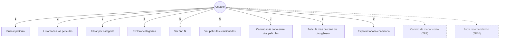

# Casos de uso — CineliList

## Diagrama general

> El único actor es el usuario objetivo definido en TP0. Las líneas punteadas
> son casos de uso previstos que todavía no están implementados.

## Caso de uso: Buscar película

- **Actor**: Usuario
- **Precondición**: el catálogo está cargado.
- **Flujo principal**:
  1. El usuario selecciona "Buscar película".
  2. El sistema pide el título.
  3. El usuario ingresa el título.
  4. El sistema lo busca en el árbol (sin distinguir mayúsculas) y muestra el resultado.
- **Flujo alternativo**: si no existe, el sistema informa que no encontró ese título.
- **Postcondición**: el usuario vio los datos de la película encontrada.

## Caso de uso: Listar todas las películas

- **Actor**: Usuario
- **Precondición**: el catálogo está cargado.
- **Flujo principal**:
  1. El usuario selecciona "Listar todas las películas".
  2. El sistema muestra todas las películas del catálogo.
- **Postcondición**: el usuario vio el catálogo completo.

## Caso de uso: Filtrar por categoría

- **Actor**: Usuario
- **Precondición**: el catálogo está cargado.
- **Flujo principal**:
  1. El usuario selecciona "Filtrar por categoría".
  2. El sistema pide el género.
  3. El usuario ingresa el género.
  4. El sistema muestra las películas de ese género.
- **Flujo alternativo**: si no hay películas en esa categoría, el sistema lo informa.
- **Postcondición**: el usuario vio solo las películas del género elegido.

## Caso de uso: Explorar categorías

- **Actor**: Usuario
- **Precondición**: el árbol de categorías está construido.
- **Flujo principal**:
  1. El usuario selecciona "Explorar categorías".
  2. El sistema muestra la jerarquía completa: géneros y sus subcategorías temáticas.
- **Postcondición**: el usuario conoce cómo se organiza el catálogo.

## Caso de uso: Ver Top N

- **Actor**: Usuario
- **Precondición**: el catálogo está cargado.
- **Flujo principal**:
  1. El usuario selecciona "Ver Top N películas".
  2. El sistema pregunta cuántas películas quiere ver.
  3. El usuario ingresa un número.
  4. El sistema muestra las N películas mejor valoradas, de mayor a menor rating.
- **Flujo alternativo**: si el usuario no ingresa un número válido, el sistema usa N = 5.
- **Postcondición**: el usuario vio el ranking.

## Caso de uso: Ver películas relacionadas

- **Actor**: Usuario
- **Precondición**: el catálogo está cargado.
- **Flujo principal**:
  1. El usuario selecciona "Ver películas relacionadas".
  2. El sistema pide el título.
  3. El usuario ingresa el título.
  4. El sistema muestra las películas conectadas en el grafo (mismo director o género), con el motivo y de mayor a menor rating.
- **Flujo alternativo**: si el título no existe, el sistema informa que no lo encontró.
- **Postcondición**: el usuario conoce qué otras películas puede ver a partir de una que le gustó.

## Caso de uso: Camino más corto entre dos películas

- **Actor**: Usuario
- **Precondición**: el catálogo está cargado.
- **Flujo principal**:
  1. El usuario selecciona "Camino más corto entre dos películas".
  2. El sistema pide la película de origen y la de destino.
  3. El usuario ingresa ambos títulos.
  4. El sistema (BFS) muestra la cadena de películas con menos conexiones, indicando el motivo de cada paso.
- **Flujos alternativos**: si algún título no existe, el sistema lo informa; si las dos películas no están conectadas por ninguna cadena, informa que no existe camino; si son la misma película, lo avisa.
- **Postcondición**: el usuario sabe cómo llegar de una película a otra.

## Caso de uso: Película más cercana de otro género

- **Actor**: Usuario
- **Precondición**: el catálogo está cargado.
- **Flujo principal**:
  1. El usuario selecciona "Película más cercana de otro género".
  2. El sistema pide el título.
  3. El usuario ingresa el título.
  4. El sistema (BFS) muestra el camino hasta la película más cercana de un género distinto y cuántas conexiones hay.
- **Flujo alternativo**: si ninguna película de otro género está conectada, el sistema lo informa.
- **Postcondición**: el usuario descubrió una recomendación fuera de su género habitual.

## Caso de uso: Explorar todo lo conectado

- **Actor**: Usuario
- **Precondición**: el catálogo está cargado.
- **Flujo principal**:
  1. El usuario selecciona "Explorar todo lo conectado a una película".
  2. El sistema pide el título de partida.
  3. El usuario ingresa el título.
  4. El sistema (DFS) lista todas las películas alcanzables y cuántas son del total.
- **Postcondición**: el usuario conoce el alcance de las conexiones de esa película.

## Casos de uso previstos (pendientes)

| Caso | Etapa | Descripción |
|---|---|---|
| Camino de menor costo | TP9 | Dados dos títulos, mostrar el camino de menor costo (con aristas pesadas) con todos los intermediarios |
| Pedir recomendación | TP10 | Sugerir películas a partir de una dada |
