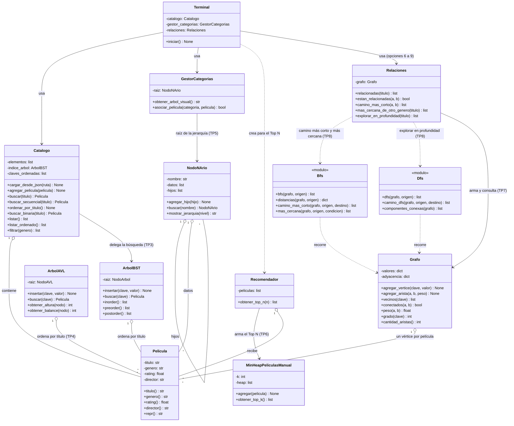

# Diagrama de clases

> Estado: **TP8**. Se actualiza en cada etapa con la estructura nueva.
> Pendiente: Dijkstra (TP9).

> `ArbolAVL` está implementado y se compara contra `ArbolBST` en
> `experimento_avl.py`; el `Catalogo` todavía indexa con el BST común.
