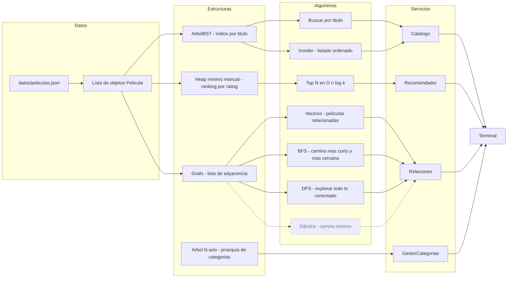

# Conexión entre estructuras

> Estado: **TP8**. Se actualiza en cada etapa. Las cajas con línea punteada son
> algoritmos **todavía no implementados** (Dijkstra).

Este diagrama muestra el **flujo de datos** de CineliList: de los datos crudos
a la terminal, pasando por cada estructura y cada algoritmo. Es el guion de la
defensa técnica.

## Qué resuelve cada estructura

| Estructura | Dónde está | Consulta que resuelve | Complejidad |
|---|---|---|---|
| Lista de `Pelicula` | `servicios/catalogo.py` | Listar, filtrar por género | O(n) |
| ArbolBST | `estructuras/arbol.py` | Buscar por título sin recorrer todo | O(log n) promedio, O(n) peor caso |
| Lista ordenada + `bisect` | `servicios/catalogo.py` | Búsqueda binaria (comparación del TP2) | O(log n) tras ordenar una vez, O(n log n) |
| ArbolAVL | `estructuras/avl.py` | Evitar que el BST degrade a lista | O(log n) garantizado |
| Árbol N-ario | `estructuras/arbol_nario.py`, `servicios/categorias.py` | Jerarquía de categorías y subcategorías | O(n) para buscar un nodo |
| Heap mínimo (manual) | `estructuras/heap.py` | Top-N sin ordenar todo el catálogo | O(n log k) |
| Grafo (lista de adyacencia) | `estructuras/grafo.py`, `servicios/relaciones.py` | Películas relacionadas (mismo director o género) | ✅ TP7: vecinos O(grado), memoria O(V + E) |
| BFS | `algoritmos/bfs.py` | Camino con menos conexiones, película más cercana de otro género | ✅ TP8: O(V + E), memoria O(V) |
| DFS | `algoritmos/dfs.py` | Explorar todo lo conectado, componentes conexas | ✅ TP8: O(V + E), memoria O(V) |
| Dijkstra | `algoritmos/caminos.py` | Camino de menor costo | ⏳ pendiente (TP9), O(E log V) |

## Notas de diseño

- El `Catalogo` mantiene **dos vistas de los mismos objetos**: la lista (orden
  de carga) y el BST (orden por título). Agregar una película actualiza ambas.
- El **AVL** está implementado y se compara contra el BST en
  `experimento_avl.py`, pero el `Catalogo` todavía indexa con el BST común.
- El **heap** lo implementamos nosotros (sin `heapq`), como pide la cátedra.
  Mantiene como máximo `k` elementos: reemplaza la raíz cuando llega uno con
  mejor rating.
- El **grafo** conecta películas que comparten director o género (no dirigido,
  todas las aristas valen 1). Detalle y ejemplos en [`tp7-grafo.md`](tp7-grafo.md).
- **BFS** (cola) responde "lo más cercano" y el camino con menos conexiones;
  **DFS** (pila, iterativa) responde "todo lo alcanzable". Comparación y
  mediciones en [`tp8-recorridos.md`](tp8-recorridos.md).
- Las mediciones que respaldan estas complejidades están en
  [`tp2-experimentos.md`](tp2-experimentos.md).
