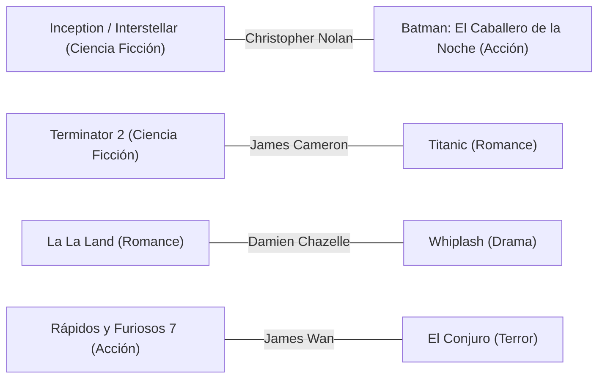

# TP7 — Grafo de relaciones entre películas

## 1. Modelo

| Elemento | En CineliList |
|---|---|
| **Vértice** | una película |
| **Arista** | dos películas están conectadas si **comparten director o comparten género** |
| **Dirigido** | **No.** La relación es simétrica: si A se parece a B, B se parece a A. |
| **Pesado** | **No (por ahora).** Todas las aristas valen 1: alcanza para "la relacionada más cercana" (BFS). El `Grafo` ya soporta pesos (`agregar_arista(a, b, peso)`) para definir un "costo" en el TP9 (Dijkstra). |

Para sostener la relación por director se agregó el campo `director` al
dataset (`datos/peliculas.json`) y a la clase `Pelicula` (opcional, por defecto
vacío).

## 2. Representación: lista de adyacencia

Se implementó como un diccionario de diccionarios: `adyacencia[a][b] = peso`,
guardado en ambos sentidos (`estructuras/grafo.py`).

**Por qué lista y no matriz de adyacencia:**

| Criterio | Lista de adyacencia | Matriz de adyacencia |
|---|---|---|
| Memoria | O(V + E) | O(V²) |
| Recorrer los vecinos de un vértice | O(grado) | O(V) |
| ¿Están conectados A y B? | O(1) (diccionario) | O(1) |
| Conviene cuando el grafo es... | ralo | denso |

Con nuestros datos: **45 vértices y 136 aristas, de 990 posibles (densidad
≈ 14 %)**. Es un grafo ralo, y a medida que crece el catálogo la mayoría de las
películas seguirán sin estar conectadas con la mayoría. Con 100.000 películas
una matriz necesitaría 10.000 millones de celdas; la lista solo guarda las
aristas que existen. Además BFS, DFS y Dijkstra (TP8 y TP9) recorren "los
vecinos de un vértice" todo el tiempo, que es justo lo barato en una lista.

## 3. Cómo se construye

`servicios/relaciones.py` agrupa las películas por género y por director y
conecta entre sí a los miembros de cada grupo. Así se evita comparar todas
contra todas: el costo es O(V + Σ g²), donde g es el tamaño de cada grupo.

`motivo_relacion(a, b)` devuelve por qué dos películas están conectadas
(*mismo género*, *mismo director* o *mismo director y género*).

## 4. Operaciones del `Grafo`

| Método | Qué hace | Costo |
|---|---|---|
| `agregar_vertice(clave, valor)` | agrega una película | O(1) |
| `agregar_arista(a, b, peso=1.0)` | conecta dos vértices en ambos sentidos | O(1) |
| `vecinos(clave)` | claves de los vértices conectados | O(grado) |
| `conectados(a, b)` / `peso(a, b)` | ¿hay arista? / su peso | O(1) |
| `grado(clave)` | cantidad de conexiones | O(1) |
| `cantidad_aristas()` | total de aristas | O(V) |

## 5. El grafo con los datos reales

- **45 vértices, 136 aristas**, grado máximo 10 (*Batman: El Caballero de la
  Noche*).
- Dentro de un género todas las películas quedan conectadas entre sí.
- **Entre géneros solo conecta el director.** Estos son los 5 "puentes" que
  tiene hoy el dataset:



- **3 componentes conexas:**

| Componente | Películas | Géneros |
|---|---:|---|
| Grande | 33 | Acción, Ciencia Ficción, Drama, Romance y Terror |
| Animación | 6 | Animación (ningún director la une con otro género) |
| Comedia | 6 | Comedia (ídem) |

Esto tiene una consecuencia útil para TP8 y TP9: entre dos películas de la
componente grande **hay camino** (por ejemplo, *Matrix → Terminator 2 → Titanic
→ La La Land → Whiplash*), y entre una de ella y una de Animación o Comedia
**no existe camino**.

## 6. Ejemplos de consultas

Desde el menú, opción **6. Ver películas relacionadas**:

```text
Opción: 6
Título de la película: matrix

--- Si te gustó Matrix (Lana y Lilly Wachowski), mirá también ---
- Inception                           ⭐8.8  (mismo género)
- Interstellar                        ⭐8.6  (mismo género)
- Terminator 2                        ⭐8.6  (mismo género)
- Blade Runner 2049                   ⭐8.0  (mismo género)
- Dune                                ⭐8.0  (mismo género)
- Arrival                             ⭐7.9  (mismo género)
- Ex Machina                          ⭐7.7  (mismo género)
```

```text
Opción: 6
Título de la película: inception

--- Si te gustó Inception (Christopher Nolan), mirá también ---
- Batman: El Caballero de la Noche    ⭐9.0  (mismo director)
- Matrix                              ⭐8.7  (mismo género)
- Interstellar                        ⭐8.6  (mismo director y género)
- Terminator 2                        ⭐8.6  (mismo género)
- Blade Runner 2049                   ⭐8.0  (mismo género)
- Dune                                ⭐8.0  (mismo género)
- Arrival                             ⭐7.9  (mismo género)
- Ex Machina                          ⭐7.7  (mismo género)
```

Desde el código:

```python
relaciones = Relaciones(catalogo.listar())
relaciones.relacionadas("Inception")                     # lista de (Pelicula, motivo)
relaciones.estan_relacionadas("Terminator 2", "Titanic")  # True  (James Cameron)
relaciones.estan_relacionadas("Matrix", "Shrek")          # False (otra componente)
```

## 7. Decisiones y limitaciones

- **Regla de relación.** Se eligió "género o director" para tener datos reales
  sin inventar atributos. Está concentrada en `motivo_relacion` y en
  `_construir`: cambiarla no toca el resto del sistema.
- **Dentro de un género todo está a distancia 1.** Por eso, para "la relacionada
  más cercana" dentro de un mismo género, BFS siempre devuelve 1 salto. Las
  consultas interesantes son las que cruzan géneros (TP8) y las que necesitan
  un costo (TP9, por ejemplo la diferencia de rating como peso).
- **Animación y Comedia quedan aisladas** con el dataset actual. Agregar más
  directores en común (o más atributos, como saga o actores) las conectaría.
- El campo `director` del dataset conviene verificarlo antes de la defensa.

## 8. Pruebas

`tests/test_grafo.py` (estructura: simetría, vecinos, grado, lazos, pesos) y
`tests/test_relaciones.py` (relaciones por género y por director, simetría,
películas sin relación, orden por rating).

```bash
python -m unittest discover tests
```
